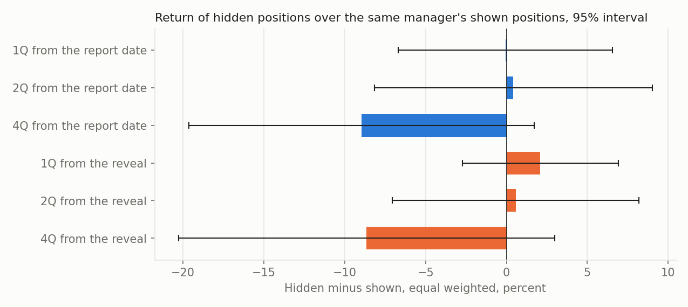

# What do hedge funds' 13F filings give away?

[](https://github.com/rxj0102/13f-timestamp-alpha/actions/workflows/ci.yml)

Managers with more than $100 million in US equities must disclose their holdings on Form 13F within 45 days of each quarter end. A manager can ask the SEC to keep a position confidential for up to a year, and file it later in an amendment. This repo asks two questions of those filings, both measured on SEC EDGAR.

1. **Are the positions a hedge fund hides better than the ones it shows?** If funds hide their best ideas, the hidden positions should earn more, and perhaps still do after they are revealed.
2. **Does the day a manager files tell you anything?** The idea this repo started from: a manager who waits until the deadline is still holding, one who files early has moved on.

Every number on this page is written by the scripts in `scripts/`, and CI fails if the page and the results disagree.

## 1. Hidden positions

<!-- hidden-headline:start (generated by scripts/render_hidden.py, do not edit by hand) -->
**Answer, from 606 manager-quarters by 72 managers, 2013 to 2026: no.** Over the two quarters after the report date, about the time a position stays hidden, the positions a manager hid returned 7.5% on average against 7.0% for the positions it showed, a difference of +0.4% (t = 0.10). In the typical manager-quarter the hidden positions do worse (median -1.6%), and over four quarters they trail by 9.0%, but the four quarter windows overlap from one quarter to the next and once that is allowed for the gap is not significant (t = -1.64). After the reveal there is nothing to trade: over the next two quarters the difference is +0.6% (t = 0.14).
<!-- hidden-headline:end -->



<!-- hidden-results:start (generated by scripts/render_hidden.py, do not edit by hand) -->
1,603 amendments revealing 100,862 hidden positions, paired with 185,992 positions shown in the same managers' original filings. Report periods 2013-06-30 to 2026-03-31. The median manager-quarter reveals 9 hidden positions against 145 shown, and the median amendment is filed 137 days after quarter end. Returns are quarter-end price changes without dividends; cells average across managers within a quarter, then across quarters, with the t-statistic across quarters. Windows of k quarters overlap from one report quarter to the next, so their t-statistics use Newey-West errors with k - 1 lags.

| Window | Quarters | Pairs | Hidden | Shown | Difference | t | Median pair | Value weighted | t |
|---|---|---|---|---|---|---|---|---|---|
| 1 quarter from the report date | 52 | 532 | +4.1% | +4.2% | -0.1% | -0.02 | -0.9% | +1.9% | +0.60 |
| 2 quarters from the report date (primary) | 51 | 525 | +7.5% | +7.0% | +0.4% | +0.10 | -1.6% | +3.8% | +0.94 |
| 4 quarters from the report date | 49 | 510 | +7.1% | +16.1% | -9.0% | -1.64 | -4.8% | -0.2% | -0.07 |
| 1 quarter from the reveal | 50 | 500 | +3.6% | +1.5% | +2.1% | +0.85 | -1.7% | +3.3% | +1.25 |
| 2 quarters from the reveal | 50 | 494 | +4.8% | +4.2% | +0.6% | +0.14 | -3.4% | +2.9% | +0.82 |
| 4 quarters from the reveal | 47 | 471 | +8.7% | +17.4% | -8.7% | -1.46 | -4.0% | -1.3% | -0.49 |

**Check: dropping securities with a suspected split instead of adjusting for it**

| Window | Difference | t |
|---|---|---|
| 1 quarter from the report date | -2.2% | -1.71 |
| 2 quarters from the report date (primary) | -4.8% | -2.16 |
| 4 quarters from the report date | -11.7% | -2.30 |
| 1 quarter from the reveal | -2.4% | -2.03 |
| 2 quarters from the reveal | -4.7% | -2.74 |
| 4 quarters from the reveal | -6.6% | -1.59 |

The six heaviest users of confidential treatment in the sample (HBK INVESTMENTS L P, Davidson Kempner Capital Management LP, UBS OCONNOR LLC, NORGES BANK, Taconic Capital Advisors LP, Alyeska Investment Group, L.P.) account for 40% of manager-quarters.
<!-- hidden-results:end -->

### Reading it

- **Hiding is not a sign of a better idea here.** On average the two sides earn the same over the time a position stays hidden, and in the typical manager-quarter the hidden side does worse. Agarwal, Jiang, Tang and Yang (2013) found the opposite for 1999 to 2007; that result does not show up in 2013 to 2026.
- **Who hides changes what is hidden.** Several of the heaviest users run event-driven and merger arbitrage strategies, where a fund keeps a stake quiet while it builds it. A merger target's upside is capped at the deal price, so its return over the next year is small next to an ordinary equity book. That reading is a hypothesis; this study does not classify positions by deal status.
- **The four quarter gap is not significant.** Equal weighted, hidden positions trail by about 9% over four quarters, but consecutive four quarter windows share three quarters, and with Newey-West errors that allow for the overlap the gap is within noise. Weighted by position size it is close to zero.
- **The split check is harsher.** Dropping every security that split during a window, instead of adjusting its price, makes the hidden side worse at every horizon and significantly so at the primary one. It compares a narrower set of stocks, so it is a check rather than the answer, but it points the same way: nothing here suggests hidden positions do better.
- **There is nothing to copy.** By the time the amendment is public, a typical four or five months after quarter end, the hidden positions earn no more than the shown ones.

### Design

| Choice | What and why |
|---|---|
| Data | SEC Form 13F data sets, every quarterly file from 2013 to 2026: cover pages, summary pages and every holding of every filer. |
| Hidden | Holdings in a 13F-HR/A whose cover page says it adds new holdings and responds to a confidential treatment request that was denied or has expired. |
| Shown | Holdings in the same manager's original 13F-HR for the same quarter, which states that confidential information was omitted. A security on both lists counts as hidden only. |
| Unit | One manager and quarter; several amendments for it are pooled. Shares only, no options. |
| Prices | Quarter-end price of each security from the 13F filings of every institution holding it: the median of value over shares, used when at least 3 filers report it. Filings whose prices sit about 1,000 times away from everyone else's (value reported in the wrong unit) are rescaled first. A security that stops appearing exits at its last price, so acquired and delisted companies stay in. |
| Splits | Filers holding a security in two consecutive quarters mostly do not trade it, so the median ratio of their shares is the split ratio when there is one. Earlier prices are divided by it. Checked in the tests against seven known splits in five stocks, and three stocks with no split under their CUSIP. Reverse splits are handled the same way but are not among the checks. |
| Primary test | Hidden minus shown, equal weighted, over the two quarters after the report date. Averaged across managers within each quarter, then tested across quarters. |
| Also reported | 1 and 4 quarters, value weights, windows starting at the first quarter end after the amendment, and a check that drops securities with suspected splits instead of adjusting. |

**Two first runs were discarded.** They used prices before the unit fix, with split rules based on total shares held, and showed average returns of several hundred percent: unit errors in the filings and missed or false splits. Between them the primary split handling was switched from adjusting to dropping suspect securities, and back once the continuing-holder rule made adjustment exact. The unit fix and that rule were added before any of the numbers above were computed. The horizons, the pairing and the primary test of hidden minus shown over two quarters did not change.

### Limits

- **Price returns only.** Dividends are not in the 13F data. Both sides lose them.
- **Quarter-end prices.** A position bought and sold inside a quarter is invisible, and windows start and end at quarter ends.
- **Survivors are not the issue, exits are.** A delisted security exits at its last quarter-end price. For an acquired company the deal price is usually close; for a bankruptcy the last price can be well above what holders got.
- **No characteristic adjustment.** The test pairs each hidden book with the same manager's shown book, which controls for the manager and the quarter, not for size, industry or deal status.
- **The confidentiality flag.** Only amendments flagged as responding to a denied or expired request are used. Funds that withdraw a request, or file an amendment without the flag, are not counted.

## 2. Filing timing

<!-- headline:start (generated by scripts/filing_timing_study.py, do not edit by hand) -->
**Answer, from 1,493 filings by 40 managers over 2014 to 2023: no, because hedge funds all file on the same day.** 94.2% of filings land on the deadline or one business day before it, the typical manager's filing day varies by 0.9 days from quarter to quarter, and in ten years only 1 filing falls in the early bucket the strategy needed for its comparison. Filing day is a constant set by the calendar, so it cannot carry information about conviction. Timing does vary across all 13F filers (30.7% file within 30 days), which is where any test would have to look. The confidential treatment data that was meant to correct the signal was mostly something else: of 6,514 positions first disclosed in amendments, 86 come from filings that say they respond to a confidential treatment request, and 90.9% come from two managers.
<!-- headline:end -->

<!-- results:start (generated by scripts/filing_timing_study.py, do not edit by hand) -->
Measured from SEC EDGAR for the 40 managers in `data/reference/manager_universe.csv`, 1,493 original 13F-HR filings for report periods 2014-03-31 to 2023-12-31.

### When hedge funds file

| Statistic | Value |
|---|---|
| Median filing day after quarter end | 45 |
| Standard deviation of filing day | 2.0 days |
| Median within-manager standard deviation | 0.9 days |
| Filed on the effective deadline (day 45, or the next business day) | 80.5% |
| Filed one business day before the deadline | 13.7% |
| Filed 2 to 5 business days before | 4.2% |
| Filed more than 5 business days before | 0.5% |
| Filed after the deadline | 1.1% |
| Filings in the strategy's EARLY bucket (day 15 or earlier) | 1 |
| Managers whose median filing day is below 40 | 0 |
| The 9 managers that pass the strategy's screen: on the deadline or one day before | 96.5% of 313 filings |
| BlackRock and Vanguard, meant as early filing controls: median day | 41 and 45 |

### When everyone else files

All 7,591 13F-HR filed in the first quarter of 2024, mostly for the period ending 2023-12-31: median day 39, 9.4% by day 15, 30.7% by day 30, 49.0% on day 40 or later. Read from the SEC full index on 2026-11-10.

### What the amendments contain

| Statistic | Value |
|---|---|
| Positions first disclosed in NEW HOLDINGS amendments | 6,514 in 82 amendments from 21 managers |
| From Citadel Advisors and Hudson Bay Capital Management | 90.9% |
| From filings stating they respond to a denied or expired confidential treatment request | 86 (1.3%), from 7 managers, 2014 to 2022 |
| In amendments that add 100 or more positions at once | 91.1%, from 10 amendments |
| Median positions per amendment, all others | 1 |
| Median delay from the report date to the amendment | 1 quarter |
| Delay of more than four quarters | 10.8% |
| Median delay for the confirmed confidential positions | 1 quarter |
<!-- results:end -->

### Reading it

- **The deadline is the strategy.** Hedge funds wait as long as the rule allows, because a 13F tells competitors what they own. Filing day is set by the calendar: when day 45 is a weekend or holiday the deadline moves, and nearly every filing moves with it. What variation remains is mostly a day either side of that.
- **There is nothing to compare.** The strategy ranked managers by how early they filed. With one early filing in ten years, the early group does not exist, and no return backtest can be run without inventing one.
- **The negative control fails too.** BlackRock and Vanguard were meant to show what an uninformative early filer looks like. They file near the deadline as well.
- **The wider population is where a test would have to go, and it has its own problem.** About a third of all 13F filers file within 30 days, so timing does vary there. None of the 40 managers here is among them, and an early versus late comparison across that population could also be comparing different kinds of manager. Who the early filers are was not measured here.
- **The confidential treatment data mostly is not confidential treatment.** An amendment that adds holdings can disclose positions that were kept confidential, or correct an omitted table. Only the filings that say they respond to a denied or expired request can be read as the first kind, and they are a small fraction. Most of the rest sit in a handful of amendments that each add hundreds of positions at once, which is a whole holdings table, not a single stake kept quiet. A study of hidden positions built on this log would mostly be studying those.

### Design

| Choice | What and why |
|---|---|
| Managers | 40 13F filers from a seed list of hedge funds and activists, two family offices, and BlackRock and Vanguard as controls, resolved to their EDGAR CIKs. The strategy's own screen (assets of $5 to $50 billion, 10 to 200 positions, hedge funds and family offices) picks 9 of them. |
| Filings | Every original 13F-HR for report periods 2014 to 2023, from the EDGAR submissions API. Amendments are counted separately. |
| Deadline | 45 calendar days after quarter end, moved to the next business day when that falls on a weekend or US federal holiday. |
| Population | Every 13F-HR in the SEC full index for the first quarter of 2024. |
| Amendments | Every 13F-HR/A of the universe managers whose cover page says NEW HOLDINGS, with the flag for a denied or expired confidential treatment request. |

### Limits

- Forty managers is a convenience sample. It covers the names a 13F strategy would follow, not every hedge fund.
- The filing date on EDGAR is a calendar date. The minute of acceptance is available and was not used; it cannot add variation to a date that is already fixed.
- The population figures cover one quarter.
- A NEW HOLDINGS amendment without the confidential treatment flag could still be a confidential position whose request was withdrawn. The log cannot tell; only the flagged rows are certain.

## What was wrong with the first version

It was a full strategy: a conviction score from filing timing, position change and size, a manager-demeaned variant, a staleness decay, a long-short backtest and a notebook. None of it had been run on real filings. Its confidential treatment log was 30 hand-written entries, none of which matched an EDGAR amendment and ten of which were private shares that never appear on a 13F. When the filing dates were measured, the premise failed before the first return.

The rebuild keeps the measurement and removes the strategy code that depended on variation that is not there.

## Reproduce

```bash
pip install -r requirements.txt
python -m pytest -q                            # tests
python scripts/hidden_study.py                 # part 1 from data/snapshot/, a few minutes
python scripts/render_hidden.py                # part 1 of this page; --check compares only
python scripts/filing_timing_study.py --check  # part 2 of this page, offline
```

To rebuild the inputs from EDGAR, which asks every client to identify itself:

```bash
export EDGAR_USER_AGENT="Your Name your.address@example.com"
python scripts/build_confidential.py   # hidden and shown filings from the 13F data sets
python scripts/build_prices.py         # quarter-end prices from all filers, about 45 minutes
python scripts/prepare_hidden.py       # freezes data/snapshot/
python scripts/build_manager_universe.py && python scripts/build_ctr_log.py   # part 2
python scripts/filing_timing_study.py
```

## Layout

```
src/hidden.py                      prices, splits, windows, pairing and tests for part 1
scripts/build_confidential.py      hidden and shown filings and holdings
scripts/build_prices.py            quarter-end prices with unit fixes and holder ratios
scripts/prepare_hidden.py          data/snapshot/ for part 1
scripts/hidden_study.py            results/hidden_summary.json and the figure
scripts/render_hidden.py           part 1 of this page
scripts/build_manager_universe.py  part 2: managers and filing history
scripts/build_ctr_log.py           part 2: positions first disclosed in amendments
scripts/filing_timing_study.py     part 2: the measurements and its part of this page
data/snapshot/                     positions, amendments and prices for part 1
data/reference/                    manager seed list, universe and amendment log for part 2
tests/                             both parts
```

## References

- Agarwal, V., Jiang, W., Tang, Y. and Yang, B. (2013). Uncovering hedge fund skill from the portfolio holdings they hide. *Journal of Finance* 68(2).
- Aragon, G., Hertzel, M. and Shi, Z. (2013). Why do hedge funds avoid disclosure? Evidence from confidential 13F filings. *Journal of Financial and Quantitative Analysis* 48(5).
- SEC Rule 13f-1 and Form 13F instructions.
